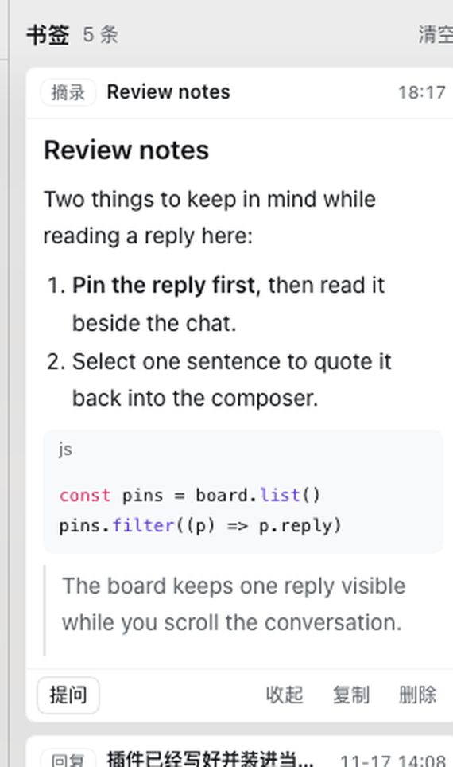

# dsh-pin-bookmarks

A right-Sidebar **bookmarks** panel for DeepSeek Harness. Pin one of the assistant's replies into the right column, read it as rendered Markdown beside the conversation, then select the part you do not understand and send it back into the main composer as a quote.

## Screenshots

Both images are from early builds: the icons and the code colouring have changed since, and neither is current.

A reply pinned on the right, rendered as Markdown beside the conversation — heading, numbered steps, a blockquote, a table and a labelled code block, with the card's own controls under it. Taken before fenced code was coloured and before the card grew its **Jump** button:



The entry points — the two icon actions in the row under a finished reply (each label appears on hover only, laid out like the row's other icon buttons). This one is a user-taken shot of an earlier build: it shows a single arrow icon inside a blue annotation box, while the row now carries a star and an arrow, both drawn in the current style:


## Why

Long answers are easier to work through beside the chat than in it: the panel keeps one reply visible while you scroll the conversation, and asking about a specific sentence is one gesture instead of retyping it.

## Use

1. **Pin.** A finished assistant reply carries two icon actions, and they are the entry points:
   - **☆ star — “Pin to bookmarks”.** Pins the reply and leaves the right column alone; nothing opens. Once the reply is pinned the ☆ is filled; clicking the ★ again unpins — every row for that message goes, the star returns to ☆, that turn's rail mark goes back to its normal tick unless another pin still colours that turn, and the column still does not open.
   - **→ arrow — “Pin and open bookmarks”.** Pins the reply and opens the right column on the **Bookmarks** tab. On a reply that is already pinned it only opens the column, and says the reply is already pinned.
   - Or open the panel from the bookmark icon in the session header, and paste arbitrary text with **+ Paste text** at the bottom of the panel.
2. **Read.** Pins render as Markdown — headings, lists (one nested level), blockquotes, tables, horizontal rules, syntax-coloured fenced code, bold/italic/strikethrough/inline code/links — not as source. Cards are expanded in full; **Collapse** folds one back to a 120 px scrolling preview.
   Each card's head carries the tag (`Reply`/`Excerpt`), the pin's title and when the message was written — the clock alone for today, `MM-DD HH:mm` for another day, and the year too once it is not this year; an excerpt shows the time it was saved. A **Jump** button in the card's footer — replies only, never excerpts — scrolls the conversation back to the message the pin came from.
3. **Ask.** Drag-select a passage; once the selection is released (two characters or more) a pill **→ Send to chat** appears beside it. Clicking it hands that passage to the chat's own insert-quote action, which puts it into the main composer — add your question and send. Without a selection, **Ask** on the card quotes the whole pin.

## Behaviour

- Pins live in browser `localStorage`, one set per session, under `dsh-pin-bookmarks:v1:<sessionId>`; a reload keeps them, clearing site data removes them. The marker appearance in **Settings → Bookmarks** is the one exception: those preferences are stored once for the whole device, under `dsh-pin-bookmarks:rail-settings:v1`, so a change there applies to every session. That change also reaches the app's other windows and sessions on this device at once, without a reload.
- The two reply icons are the entry points: the star pins in place and takes the pin off again, the arrow pins and opens the column.
- A pinned turn's tick on the right edge of the conversation — the turn navigator — gets longer, thicker and brightly coloured: 26 px wide by default and 4 px tall, against the 20 px the longest normal tick reaches. Each pinned turn takes a colour of its own from a six-swatch bright palette, and a bright hue of its own once all six are in use. This colouring needs the turn to be loaded in the transcript: markers exist only for turns that are currently loaded, and several pinned replies inside one turn share that turn's single mark.
- **Settings → Bookmarks** is where that appearance is set, and it does nothing else: **Use one color** (off by default, with a colour picker while it is on), **Use one length** (on by default, with a 22–28 px slider in 1 px steps, default 26, while it is on), and a preview of the effect. Even the shortest pin marker is longer than a normal tick.
- Pins written before the plugin recorded a pin's turn carry none. For those it asks the session history — passively, 30 messages a page, one walk per Session at a time, and only until it has what it needs — to learn which turn each pin belongs to, so its marker can be coloured. A pin the walk cannot place keeps no marker, and its card says so.
- The label under an icon action is a bubble: it comes up after a short hover and goes when the pointer leaves. A click's feedback takes the bubble over and stays for six seconds, pointer or no pointer. The panel's own line at its foot lasts the same six seconds.
- Pins hold at most 40 entries per session; the oldest is dropped past that.
- Every write merges against what is already stored rather than the in-page cache, so a reload between two writes cannot drop a pin.
- Quotes are capped: **Ask** on a pinned reply sends at most 2000 characters (that reply is already in the session log); a passage you select, or text you paste, up to 6000. The overflow is marked `… (truncated)` — `…（后略）` in Chinese.
- **Jump** finds the message through the conversation's own anchor keys. When the row is not paged in yet, it walks backwards through the chat's own *load older* control until the row appears, then centres on it. It ends in one of three ways, each with its own line: the row appears; the start of the conversation is reached and the row is not in it (the *load older* control is gone or disabled); or the walk runs out of budget — 15 seconds, 60 pages, or 8 pulls in a row with the conversation not growing while the control is still clickable — and it then reports only how many pages it tried, without claiming to have reached the start.
- Pins made before 0.1.3 carry the time they were pinned; from 0.1.3 on, a reply's pin carries the time the reply was written, and an excerpt the time it was saved.
- Only the session on screen has a composer. Where it is missing, or where it refuses a quote because another submission is still in flight, the panel copies the passage to the clipboard and says so instead.
- The Markdown renderer is the plugin's own and deliberately small: no math, no Mermaid, no raw HTML, no images. Those show as text. Links open only `http(s)` and `mailto` targets; anything else stays text.
- Fenced code is coloured with the theme's own shiki palette (`--shiki-token-*`), so a block is coloured as it is in the conversation and follows light/dark with the rest of the app. Recognised tags: `js`/`jsx`/`ts`/`tsx` — also `mjs`, `cjs`, `mts`, `cts`, `javascript`, `typescript`; `py`/`python`/`py3`; `go`/`golang`; `rs`/`rust`; `sh`/`bash`/`zsh`/`shell`/`console`; `sql` — also `mysql`, `sqlite`, `postgres`, `psql`; `json`/`jsonc`; `yaml`/`yml`. Anything else stays in plain monospace rather than guessing.

> Renamed from `dsh-ask-reader` in 0.3.0. Pins made under the old name are read once and copied to the new storage key, and the rail preferences fall back to the old key until you change them; the old keys themselves are left in place. Nothing is lost, and the old install address keeps working through GitHub's redirect.

## Install

From the repository, or from the prebuilt tarball attached to [the latest release](https://github.com/zbh13782-lang/dsh-pin-bookmarks/releases/latest):

```sh
dsh plugin --profile <profile> add github:zbh13782-lang/dsh-pin-bookmarks
# or
dsh plugin --profile <profile> add https://github.com/zbh13782-lang/dsh-pin-bookmarks/releases/latest/download/dsh-pin-bookmarks.tgz
```

Or, in DSH Desktop, **Settings → Plugins → Add plugin** and paste either address. The package declares `dsh.bundle`, ships no dependencies, no build step and no install scripts — a tarball install therefore skips the build-approval prompt.

The same two addresses work unchanged on Windows and Linux: the plugin is a browser bundle, `index.js` is empty, and nothing in it reads a path, a shell or an OS name. The tarball is plain `.tgz` (distil with `tar -xzf` if you want to read it), and `tar` ships with Windows 10 and later.

If your profile shows this plugin as a **`link:` entry pointing into a local directory** — for example `link:/Users/you/dsh-plugins/dsh-pin-bookmarks` — that row came from a directory install on another machine and cannot work here: Plugins reports it as *指向本地目录，本机不存在*. Remove that row and install from one of the two addresses above instead; nothing in the plugin needs to change.

## Layout

| Path | Role |
| --- | --- |
| `client.js` | The whole browser half: tab type, panel body, Markdown renderer and code colouring, the two reply actions, the settings section, the header entry |
| `index.js` | Host half (empty — the bundle row needs a module) |
| `cordis.patch.yml` | Loader row inserted by the bundle |
| `locale/*.json` | Plugin Manager title/description |
| `docs/DETAIL.md` | The detail page shown in Plugin Manager |

## Licence

MIT.